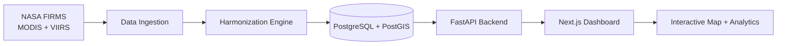

# FireLens

**One view of fire activity. Powered by NASA satellite data.**

FireLens is a geospatial web platform developed by **Team Supernova-X** for **NASA Space Apps Cairo 2026**. It brings together active-fire detections from NASA's **MODIS** and **VIIRS** instruments to help users explore fire activity across locations and time through a unified, interactive dashboard.

> **Project status:** Hackathon prototype. Features and deployment details will be updated as development progresses.

## The challenge

MODIS and VIIRS provide valuable observations of active fires, but their records differ in spatial resolution, observation characteristics, and coverage periods. Simply concatenating their detections can produce misleading trends and duplicate observations.

FireLens aims to make these complementary datasets easier to compare and explore while preserving their provenance and differences.

## Our solution

FireLens is designed to:

- **Ingest** NASA FIRMS active-fire records from MODIS and VIIRS.
- **Harmonize** source fields, timestamps, coordinates, and confidence information into a consistent data model, retaining sensor-specific metadata.
- **Explore** detections on an interactive map with geographic and temporal filters.
- **Analyze** fire activity through timelines, summaries, and visualizations.
- **Support decisions** by making satellite fire observations more accessible and interpretable.

**Important:** Satellite active-fire detections are observations, not confirmed wildfire boundaries or burned-area estimates. Sensor differences, overpass frequency, clouds, and detection limitations must be considered when interpreting trends. FireLens is not a replacement for operational emergency warning systems.

## Architecture

The harmonization pipeline standardizes the records while retaining their original sensor identity and relevant quality indicators. The API serves geospatial and temporal queries to the dashboard.

## Tech stack

| Layer | Technologies |
| --- | --- |
| Frontend | Next.js, React, TypeScript, Tailwind CSS |
| UI | shadcn/ui, Radix UI |
| Maps | React Leaflet |
| Charts | Recharts |
| Data fetching | TanStack Query |
| Backend | Python, FastAPI |
| Database | PostgreSQL, PostGIS |
| Data sources | NASA FIRMS (MODIS and VIIRS) |

## NASA data sources

- [NASA FIRMS](https://firms.modaps.eosdis.nasa.gov/) — Fire Information for Resource Management System.
- [FIRMS API documentation](https://firms.modaps.eosdis.nasa.gov/api/) — access to active-fire data.
- [NASA Earthdata](https://www.earthdata.nasa.gov/) — background on NASA Earth-observation data.

Please follow the applicable NASA data-use guidance and include appropriate dataset attribution in outputs.

## Planned workflow

1. Select an area of interest and time range.
2. Retrieve or query available MODIS and VIIRS detections.
3. Standardize records and preserve source-specific attributes.
4. Query the unified dataset through the backend API.
5. Inspect detections and trends in the FireLens dashboard.

## Getting started

The repository's installation and run commands will be documented once the frontend, backend, and data-pipeline structure is finalized. Configuration values such as database credentials and NASA FIRMS API keys should be provided through environment variables and never committed to Git.

## Team Supernova-X

| Member | Role |
| --- | --- |
| Noureldin Hossam | Team Leader · Full-Stack Developer · System Architect |
| Ahmed Badr | Backend Developer |
| Youssef Ahmed | Data Engineer |
| Nader Sherif | Data Engineer |
| Mohamed Sherif | Data Scientist |
| Yara Ibrahim | Data Scientist · Storyteller |

## Event

Built for **NASA Space Apps Challenge 2026 — Cairo Local Event**.

## Acknowledgments

We acknowledge NASA and the FIRMS team for providing access to MODIS and VIIRS active-fire observations. FireLens is an independent hackathon project and is not an official NASA product.

## License

A license has not yet been specified. Add a `LICENSE` file before describing the repository as open-source.
